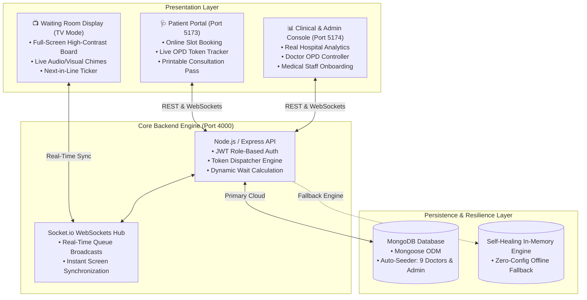

# Curamed 2.0 – Intelligent Hospital & Real-Time OPD Queue Management System 🏥⚡

[](https://nodejs.org/)
[](https://react.dev/)
[](https://www.mongodb.com/)
[](https://socket.io/)
[](https://vitejs.dev/)

**Curamed** is an enterprise-grade hospital outpatient department (OPD) appointment and real-time digital queue management system. Engineered to eliminate physical waiting lines and chaotic clinic lobbies, Curamed provides automated OPD token sequencing, live doctor queue controllers, public waiting-room TV displays, and digital patient boarding passes.

---

## 🏛️ System Architecture



---

## ✨ Key Capabilities & Engineering Highlights

### 1. 🎟️ Smart OPD Token Allocation Engine
- **Sequential Daily Tokens**: Automatically assigns structured tokens per specialty and doctor (e.g. `OPD-PED-01`, `OPD-PED-02`, `OPD-CAR-01`).
- **Dynamic Estimated Wait Time (ETA)**: Calculates patient waiting times on the fly based on the doctor's average consultation duration and the number of patients ahead in line.
- **Formal OPD Boarding Pass**: Generates an official, printable outpatient slip containing barcode/token code, assigned cabin number, and hospital instructions.

### 2. 👨‍⚕️ Doctor OPD Station Controller (`/queue`)
- Dedicated doctor workstation to admit and manage patients.
- **One-Click "Call Next Patient"**: Automatically archives the current consultation as `Completed`, advances the next queued patient to `Serving`, and stamps exact consultation timestamps.
- Displays full patient intake summary (contact, age, gender, medical department, past visit history).

### 3. 📺 Full-Screen Digital Waiting Room TV (`/waiting-room`)
- Designed for wall-mounted TV monitors in hospital waiting lounges.
- **Giant Glowing "NOW CALLING" Display**: Large token codes visible across the room with routing instructions: **"PLEASE PROCEED TO CABIN 101"**.
- Animated visual chime that flashes when a new patient token is called.
- High-visibility "UP NEXT IN QUEUE" table and hospital safety announcements.

### 4. 📈 Real-Time Hospital Operational Analytics
- Executive dashboard tracking **Today's OPD Volume**, **Active Waiting Queue**, **Completed Consultations**, and **Doctors On Duty**.
- Real database aggregation replacing hardcoded statistics.
- Department workload distribution breakdown across all 9 medical specialties.

### 5. 🛡️ Self-Healing Database & Zero-Config Seeding
- **Smart Cloud-to-Local Fallback**: Automatically connects to MongoDB Atlas or local MongoDB; if cloud connectivity or internet is unavailable, smoothly spins up an embedded in-memory MongoDB instance.
- **Auto-Seeder**: Automatically creates 9 specialist doctors with real cabins, an Administrator account, a Demo Patient account, and today's active live queue on first boot!

---

## 👥 Pre-Configured Demo Credentials

For testing and grading evaluations, the following accounts are pre-seeded in the system:

| Role | Email | Password | Access Portal |
| :--- | :--- | :--- | :--- |
| **Hospital Administrator** | `admin@curamed.com` | `Password123!` | [Clinical Console (5174)](http://localhost:5174/login) |
| **Verified Patient** | `patient@curamed.com` | `Password123!` | [Patient Portal (5173)](http://localhost:5173/login) |

> ⚡ *Both portals feature a **"One-Click Demo Login"** button on their sign-in pages for instant access.*

---

## 🏥 Medical Specialists Pre-Seeded in the System

| Doctor Name | Department Specialty | Assigned OPD Cabin | Avg. Consultation |
| :--- | :--- | :--- | :--- |
| **Dr. Sarah Johnson** | Pediatrics | Cabin 101 (OPD) | 15 mins |
| **Dr. Michael Chang** | Orthopedics | Cabin 102 (OPD) | 20 mins |
| **Dr. Elena Rostova** | Cardiology | Cabin 201 (Cardio Wing) | 20 mins |
| **Dr. David Chen** | Neurology | Cabin 202 (Neuro Wing) | 25 mins |
| **Dr. Maya Patel** | Oncology | Cabin 301 (Cancer Care) | 30 mins |
| **Dr. Alexander Wright** | Radiology | Cabin 302 (Imaging Wing) | 15 mins |
| **Dr. Chloe Bennett** | Dermatology | Cabin 104 (Skin Care) | 15 mins |
| **Dr. James Wilson** | ENT | Cabin 105 (ENT Wing) | 15 mins |
| **Dr. Liam Foster** | Physical Therapy | Cabin 106 (Rehab Wing) | 25 mins |

---

## 🚀 How to Run the Project Locally

### Prerequisites
- [Node.js](https://nodejs.org/) v18 or higher
- npm v9 or higher

### 1. Start the Backend API & Queue Engine
```bash
cd hospb
npm install
node server.js
```
*Server starts on `http://localhost:4000` with WebSockets and self-healing database.*

### 2. Start the Patient Portal
```bash
cd Frontend
npm install
npm run dev
```
*Patient portal runs on `http://localhost:5173`.*

### 3. Start the Clinical & Admin Console
```bash
cd dashboardd
npm install
npm run dev
```
*Clinical console runs on `http://localhost:5174`.*

---

## 📡 REST API Reference Summary

### Authentication & Users (`/api/v1/user`)
- `POST /patient/register` – Register new patient account.
- `POST /login` – Role-based login (Admin, Doctor, Patient).
- `GET /doctors` – List all verified doctors with cabin info and departments.
- `GET /doctors/available` – Query doctor availability and appointment slots.
- `POST /doctor/addnew` – Onboard new doctor (Admin only).
- `GET /admin/me` & `GET /patient/me` – Retrieve authenticated session profile.

### OPD Queue & Appointments (`/api/v1/appointment`)
- `POST /post` – Book appointment and generate official sequential OPD token.
- `GET /my` – Patient's active OPD token pass, estimated wait time, and history.
- `GET /live-queue` – Real-time queue state for waiting room TVs (`currentlyServing`, `nextInLine`).
- `POST /call-next` – Doctor calls next waiting patient (advances queue).
- `PUT /update/:id` – Update status (`Waiting`, `Serving`, `Completed`, `Cancelled`).
- `GET /analytics` – Dynamic operational metrics for executive dashboard.
- `GET /getall` – Filterable master appointment roster.

---

## 🛠️ Project Structure

```
Hospital_Queue_Management_System/
├── hospb/                             # Backend API & WebSocket Engine
│   ├── config/config.env.example     # Environment configuration template
│   ├── controller/                    # Business logic (Queue, Appointments, Users)
│   ├── database/                      # DB Connection & Auto-Seeder
│   ├── middlewares/                   # Role-Based Auth & Global Error Handlers
│   ├── models/                        # Mongoose Schemas (User, Appointment, Message)
│   ├── router/                        # Express API Routers
│   ├── utils/                         # JWT Token & Cookie Utilities
│   └── server.js                      # HTTP Server & Socket.io Initializer
│
├── Frontend/                          # Patient Portal (React 18 + Vite)
│   ├── src/components/                # Navbar, Hero, Departments, MyAppointments, etc.
│   ├── src/pages/                     # Home, Appointment, Login, Register, Aboutus
│   └── src/App.css                    # Clinical Design System & Print Styles
│
└── dashboardd/                        # Clinical & Admin Console (React 19 + Vite)
    ├── src/components/                # Dashboard, OpdQueueController, WaitingRoomTv, etc.
    └── src/App.css                    # Dark TV Display & Executive Console Theme
```

---

## 🎓 Final-Year Capstone Project Highlights
- **Real-Time Architecture**: True WebSockets sync between patient smartphone, doctor cabin, and hospital lobby TV.
- **Enterprise Error Resilience**: Graceful degradation from cloud Atlas to embedded memory MongoDB.
- **User Experience**: Clinical-grade UI, responsive layout, print-ready passes, and zero-confusion token sequencing.
- **Clean Code Standards**: Modular MVC separation, unified REST naming, zero lint warnings, and full cross-platform compatibility.
